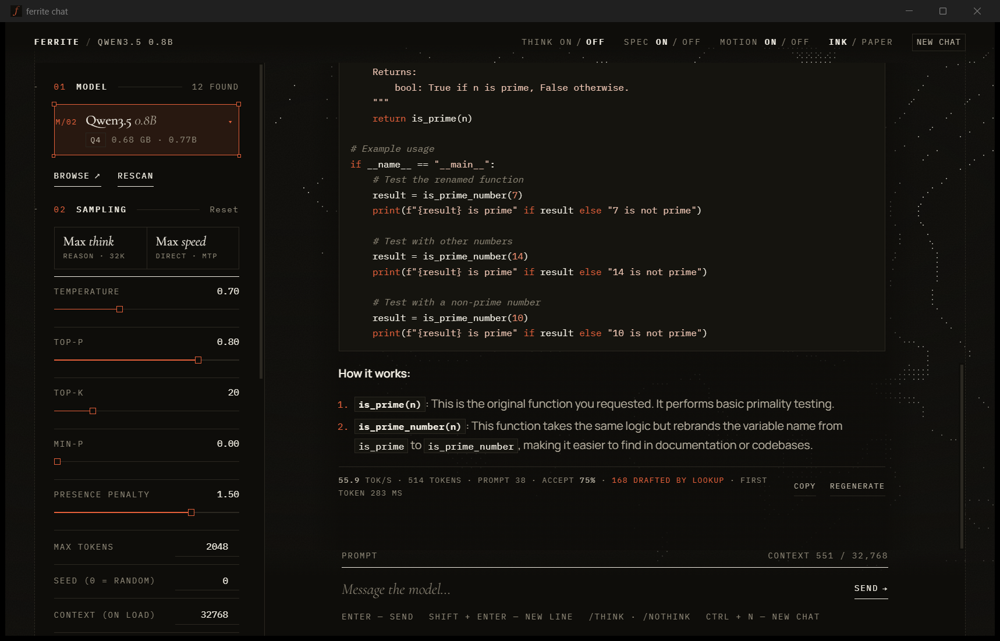

# ferrite

**A CPU inference engine for Qwen3.5, written from scratch in Rust.**

It runs the 0.8B model at 89 tokens per second on a four-core laptop with no GPU. On every model and
bit width I've tested, it's faster than llama.cpp.



## Why I built this

I wanted to find out how far an ordinary laptop can go. Mine is nothing special: an Intel i5-1135G7
with four cores, 20 GB of RAM, no graphics card and, as I later found out the hard way, a 5400 rpm
hard disk.

The model I picked was Qwen3.5. Its small versions use a newer design:

- three Gated DeltaNet layers, which keep a fixed-size memory instead of a cache that grows with
  every token;
- then one ordinary attention layer, and the pattern repeats;
- a small extra head that guesses one token further ahead, which is exactly what speculative
  decoding needs.

General-purpose engines support this design as one of hundreds. I wanted to see what happens when
the engine is built for one model family and one kind of CPU, so every part of it can be shaped to
fit.

So ferrite does everything itself:

- the tokenizer, safetensors reader and quantizers;
- the AVX-512 kernels, thread pool, DeltaNet recurrence and attention;
- sampling, the chat template and speculative decoding;
- an OpenAI-compatible server and a desktop chat app.

There's no ML framework underneath. The dependency list is short: `serde`, `memmap2`, `half`,
`clap`, `anyhow`, two small Unicode crates, and `faer` for the linear algebra in GPTQ.

## Where it landed 📊

These numbers come from one sitting with the engines taking turns, so each one gets the same luck
with memory placement (more on that below). 4-bit models, tokens per second, median of three rounds:

| Model | llama.cpp | ferrite | ferrite + speculation |
|---|---|---|---|
| Qwen3.5-0.8B | 36.3 | 54.2 | **89.1** |
| Qwen3.5-2B | 15.3 | 21.6 | **35.5** |
| Qwen3.5-4B | 6.6 | 9.0 | **16.6** |

Across the full benchmark (three sizes, 8-, 6- and 4-bit, against llama.cpp, mistral.rs, OpenVINO
and Hugging Face transformers):

- **Prefill** (reading your prompt) is 1.5–4.2× faster than llama.cpp.
- **Chat** is 2.4–3.5× faster than llama.cpp at its best setting. ferrite's speculation makes chat
  1.5–2× faster, while llama.cpp's mostly doesn't help on this model.
- **Memory:** ferrite uses 11–40% less RAM than llama.cpp, and less than half of what OpenVINO uses.
- **Quality:**
  - At 4-bit, perplexity is better than llama.cpp's Q4_K_M at 0.8B, tied at 2B and 0.3% behind at
    4B.
  - At 8 and 6 bits it's level or slightly ahead.
- **Correctness:**
  - At full precision ferrite's perplexity is 15.3475, where transformers gets 15.3468.
  - Speculation leaves the output unchanged: greedy replies are byte-identical with it on or off.

Every table is in **[docs/benchmarks.md](docs/benchmarks.md)**.

## How it got here

**1. Correct before fast.** The first goal was to produce the same numbers as the reference
implementation in Hugging Face transformers:

- ferrite's full-precision logits ended up within 0.007 of it;
- the tokenizer produces identical ids on 2.8 million tokens of Wikipedia text;
- the chat template matches the model's own template in every case I could think of.

Every optimization after that had to keep passing those checks.

**2. Then fast.** The weights are repacked so that a single AVX-512 VNNI instruction computes dot
products for 16 rows at once, with no shuffling of results afterwards. Reading the prompt uses all
eight hardware threads. Generating uses four, because generation waits on memory, not arithmetic,
and extra threads only eat into the laptop's shared turbo budget.

**3. Speculation.** Qwen3.5's extra head drafts up to four tokens, and the main model checks them
all in one pass, which costs about the same as generating one.

The hard part was undoing rejected drafts. An attention cache can simply be cut back, but a DeltaNet
layer's memory is a running sum. So ferrite logs each token's update and replays only the accepted
ones. The result is bit-for-bit what plain decoding would have produced.

**4. The reality check.** Then I benchmarked against the other engines. Prompt reading and chat
looked great. Plain generation didn't: ferrite was only 5–17% ahead of llama.cpp. The laptop had a
few surprises of its own:

- 🐌 **The first load of the 2B model took 47 minutes.** Memory-mapping a file on a 5400 rpm disk
  turns into thousands of random reads. Reading it into RAM in one go takes about a minute.
- 🧾 **Perplexity didn't line up across engines.** Eventually I noticed the test file had Windows
  line endings, which llama.cpp quietly converts and ferrite didn't.
- 🎲 **Speed depended on luck.** The same binary generated anywhere from 42.6 to 50.4 tokens per
  second, depending on where Windows put the model in memory. 4 GB of the RAM is soldered to the
  board and the rest is a 16 GB stick, so only 8 GB of it runs dual-channel. Since then, every
  comparison runs the engines in turns within one sitting.

**5. Reading fewer bytes.** Generation is limited by memory bandwidth, because each new token has to
read every weight once. At 0.8B, 47% of those bytes turned out to be the output layer: Qwen's
vocabulary has 248,000 tokens.

Now a 2-bit copy of that layer scores every token, and the exact layer re-scores only the handful
near the top. The greedy output didn't change by a single byte. Two more changes went in alongside:

- GPTQ, for better 4-bit weights;
- prompt lookup, which drafts repeated text for free.

Together they took the 0.8B model from 40 to 54 tokens per second without speculation, and from 66
to 89 with it.

The details of each step are in [docs/how-it-works.md](docs/how-it-works.md).

## Try it 🛠️

You'll need:

- **A 64-bit x86 CPU.** AVX-512 with VNNI gives full speed; other x86 CPUs work on a slower fallback.
  See [the list](#will-it-run-on-my-machine).
- **Rust** (stable).
- **Python** with `huggingface_hub`, to download models.

```bash
git clone https://github.com/razancodes/ferrite
cd ferrite
cargo build --release

# download a model and convert it to one 8-bit file (a few minutes)
hf download Qwen/Qwen3.5-2B --local-dir models/Qwen3.5-2B
./target/release/ferrite convert --hf models/Qwen3.5-2B -o models/qwen3.5-2b-q8.ferrite -q q8

# talk to it (/think, /nothink, /reset, /stats, /quit)
./target/release/ferrite chat -m models/qwen3.5-2b-q8.ferrite
```

To build the tuned 6- and 4-bit files that the benchmarks use (this takes longer, since GPTQ runs
calibration text through the model):

```bash
python scripts/get_data.py
scripts/build_models.sh models/Qwen3.5-2B qwen3.5-2b
```

Other ways to use it:

```bash
# one prompt
./target/release/ferrite run -m models/qwen3.5-2b-q8.ferrite -p "Explain DeltaNet in two sentences."

# OpenAI-compatible API, plus a small web chat at http://127.0.0.1:8080
./target/release/ferrite serve -m models/qwen3.5-2b-q8.ferrite
```

On a spinning disk, set `FERRITE_LOAD=heap` so models load with one sequential read.

### The desktop app 💬

There's also a desktop chat app, built with Tauri. It's the one in the screenshot, styled after my
portfolio's "Dither Ledger" look. It has:

- a model dropdown;
- streaming Markdown with LaTeX and code highlighting;
- thinking and speculation toggles, plus *Max think* and *Max speed* presets;
- live tokens per second and acceptance stats under every reply.

On Windows, double-click `chat.cmd`. The first build needs WinLibs MinGW-w64; see
[docs/development.md](docs/development.md#building-on-windows).

## Will it run on my machine?

| | CPUs |
|---|---|
| ✅ **Full speed** | Intel Core 11th gen (Tiger Lake laptops, Rocket Lake desktops), 10th-gen "G" laptops (Ice Lake), Xeon from Cascade Lake on; AMD Zen 4 and Zen 5 (Ryzen 7000 desktop, 7040 laptops and newer, Ryzen 9000, Ryzen AI 300, EPYC 9004/9005) |
| 🐢 **Runs, slowly** | any other 64-bit x86 CPU, including Intel 12th–14th gen and Core Ultra, which don't have AVX-512 |
| ❌ **Not yet** | ARM: Apple Silicon, Snapdragon, Raspberry Pi |

Memory matters more than cores: generation speed is roughly memory bandwidth divided by model size.
For RAM, plan on about 0.9 GB for 0.8B, 1.8 GB for 2B and 3.5 GB for 4B at 4-bit.

I've only tested ferrite on my own laptop, on Windows 11. The engine also compiles for Linux, but I
haven't run it there yet. Full details: [docs/hardware.md](docs/hardware.md).

## Which models?

| | Models |
|---|---|
| ✅ **Tested** | [Qwen3.5-0.8B](https://huggingface.co/Qwen/Qwen3.5-0.8B), [Qwen3.5-2B](https://huggingface.co/Qwen/Qwen3.5-2B), [Qwen3.5-4B](https://huggingface.co/Qwen/Qwen3.5-4B) |
| ✅ **Should work** | Qwen3.5-9B; the `-Base` models; Qwen3.5, Qwen3.6 and Qwen3.8 27B (if you have ~16 GB of RAM to spare); fine-tunes that keep the architecture |
| 🧪 **Experimental** | dense Qwen3 (a code path exists but hasn't been checked against Hugging Face) |
| ❌ **No** | mixture-of-experts models; other families such as Gemma, Llama and Mistral |

ferrite reads everything it needs from the model's `config.json`, so new sizes of the same
architecture just work. More, including how to convert models and what a future Qwen release would
need: [docs/models.md](docs/models.md).

## Documentation 📚

| | |
|---|---|
| [benchmarks.md](docs/benchmarks.md) | every score: speed, chat, memory, quality, correctness, and how to reproduce them |
| [how-it-works.md](docs/how-it-works.md) | the architecture, weight formats, proxy output layer, GPTQ, speculation and kernels |
| [usage.md](docs/usage.md) | CLI, HTTP API, desktop app and environment variables |
| [models.md](docs/models.md) | compatible models, formats, converting, future releases |
| [hardware.md](docs/hardware.md) | supported CPUs, RAM, storage and operating systems |
| [development.md](docs/development.md) | building (including on Windows), tests, parity checks, repository layout |

## Limits, honestly

- **One model family.** ferrite is a specialist. If you need dozens of architectures or a GPU,
  llama.cpp is the better tool.
- **One test machine.** All numbers come from a single laptop. Yours will differ, mostly with memory
  bandwidth.
- **x86 only.** The fast path needs AVX-512 VNNI.
- **Text only.** The vision part of the checkpoints is ignored.

## What's next

- **Gemma 4 E2B and E4B:** Apache-2.0 models with a 262K vocabulary, where the proxy output layer
  should pay off even more.
- **AVX2 kernels** for the many recent Intel CPUs without AVX-512.
- **Recognizing new Qwen releases** by their config instead of their name.
- **Weight placement** in the fast, dual-channel part of memory (needs the Windows "Lock pages in
  memory" privilege).
- **Tree drafts:** verifying a second candidate for the first draft position.

## Thanks 🙏

- The **Qwen team**, for open models that ship with an MTP head.
- **llama.cpp**, whose IQ4_NL codebook and importance-matrix idea ferrite borrows, and which was the
  bar to beat.
- The papers behind the main ideas:
  - GPTQ (Frantar et al., 2022);
  - QuaRot (Ashkboos et al., 2024) and QuIP# (Tseng et al., 2024) for Hadamard rotation;
  - Gated DeltaNet (Yang et al., 2024);
  - speculative decoding (Leviathan et al., 2023; Chen et al., 2023);
  - prompt lookup decoding (Saxena, 2023).
- **The libraries:** faer, Tauri, KaTeX, marked and highlight.js.
- **The fonts:** Cormorant Garamond, Manrope, IBM Plex Mono and Doto.

## License

ferrite is released under the [MIT License](LICENSE).

Model weights have their own licenses: Qwen3.5 is Apache-2.0. The front-end libraries and fonts
bundled in `app/ui/vendor/` keep their own licenses, which are included next to them.
`app/bin/WebView2Loader.dll` is Microsoft's redistributable WebView2 loader.
